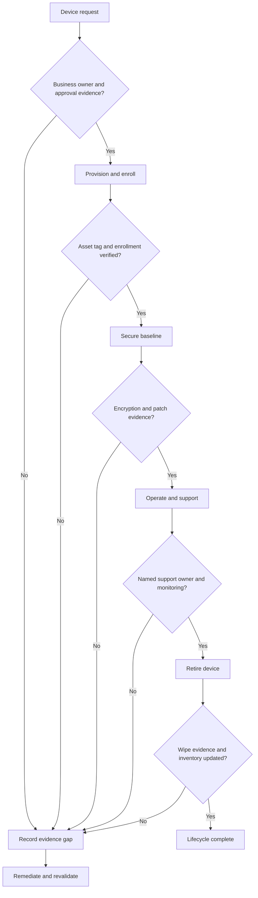

# Endpoint lifecycle reference workflow

Vendor-neutral training illustration, not an employer-approved standard operating procedure.

The public `app.py` evaluates required evidence flags by lifecycle stage; the diagram expresses the intended review sequence. It is not a substitute for endpoint security, compliance, retention or hardware lifecycle requirements.

Run `python cli.py examples/sample_evidence.json` for a fictional complete record.
